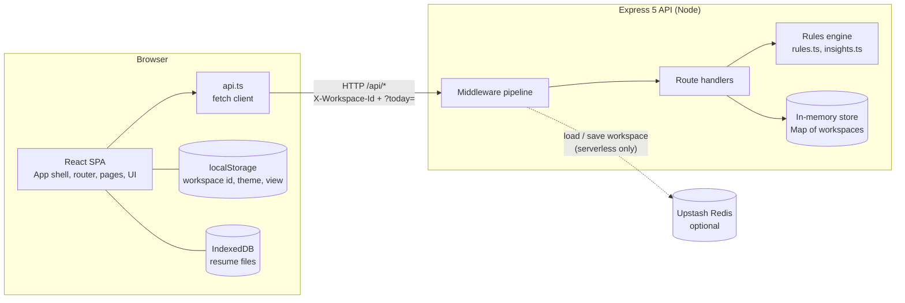
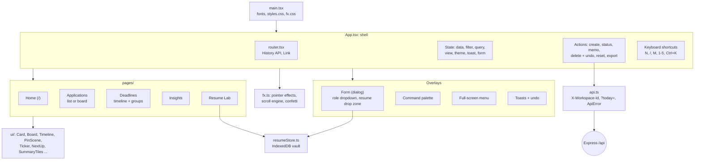
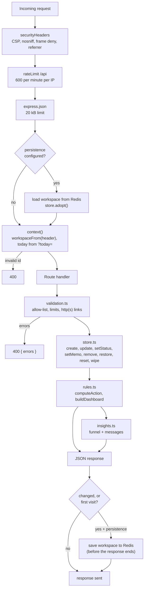
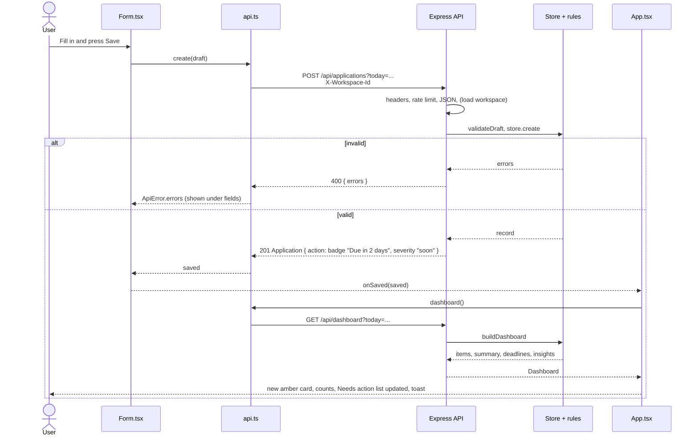
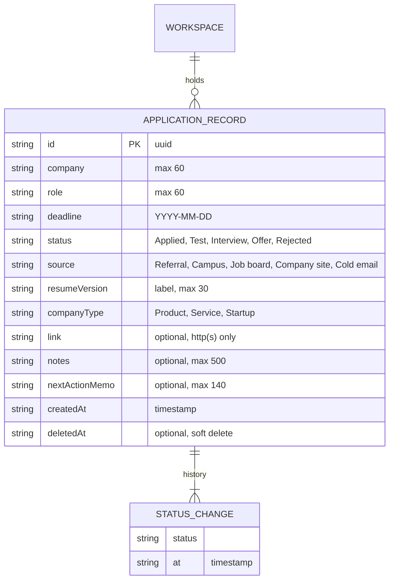
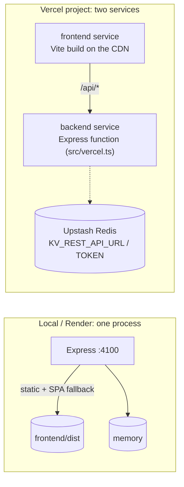

# NextUp: low-level design

NextUp is a single-page React app plus a small Express API. The backend owns every rule (validation,
deadline maths, "needs action", insights); the frontend renders what the API returns and refetches the
dashboard after every change. The diagrams below render on GitHub.

## 1. System overview

Resume files never reach the server: they are stored in IndexedDB only.

## 2. Frontend (Vite, React 19, TypeScript)

**Data flow rule:** every successful `POST`, `PUT`, `PATCH` or `DELETE` is followed by `GET /api/dashboard`,
and the whole `Dashboard` object replaces state. Pages are pure views of that object plus local UI state
(filter, search, board/list view).

| Concern | Where |
|---|---|
| Routing | `router.tsx`: `useRouter`, `Link`, `RouterContext`. Real URLs, Back/Forward, deep links |
| API contract | `types.ts` (mirrors `backend/src/types.ts`), `api.ts` |
| Resume vault | `resumeStore.ts`: IndexedDB, type, size and file-signature checks, download only |
| Scroll and hover effects | `fx.ts` (+ `fx.css`): reveals, depth tilt, pinned 3D scene, magnetic buttons, cursor ring |
| Theme | `data-theme` on `<html>`; saved only after an explicit toggle |

## 3. Backend (Express 5, TypeScript, no build step locally)

### API

| Method | Path | Purpose |
|---|---|---|
| GET | `/api/health` | liveness |
| GET | `/api/dashboard` | items (sorted by urgency), summary, deadlines, insights |
| POST | `/api/applications` | create (201) or `400 { errors }` |
| PUT | `/api/applications/:id` | edit |
| PATCH | `/api/applications/:id/status` | change status (appends to history) |
| PATCH | `/api/applications/:id/memo` | set or clear the next-action memo |
| DELETE | `/api/applications/:id` | soft delete |
| POST | `/api/applications/:id/restore` | undo a delete |
| DELETE | `/api/applications` | wipe the workspace |
| POST | `/api/demo/reset` | reload demo data |
| GET | `/api/export.ics` | upcoming deadlines as a calendar file |

Every request carries `X-Workspace-Id` (random id kept in the browser) and `?today=YYYY-MM-DD`
(the browser's local date), so the server never guesses the day.

### The "needs action" rules (`rules.ts`)

| Condition (not Rejected) | Severity | Needs action |
|---|---|---|
| deadline in the past | `overdue` | yes |
| deadline in 0 to 3 days | `soon` | yes |
| Applied and quiet for 14+ days | `stale` | yes |
| anything else open | `ok` | no |
| Rejected | `closed` | no |

Sorting is by urgency, then deadline, then company. All of it is computed per request and never stored.

## 4. Sequence: create an application (the judge path)

## 5. Data model

| Store | Technology | Key and contents |
|---|---|---|
| Server memory (default) | JavaScript `Map` | workspace id to `ApplicationRecord[]`. 200 records per workspace, 500 workspaces |
| Redis (optional, serverless) | Upstash over REST | `nextup:ws:<workspace-id>` = JSON array, expires after 14 days |
| Browser | IndexedDB `nextup-resumes` / `files` | resume file per version label (never uploaded) |
| Browser | localStorage | `nextup:workspace`, `nextup:theme`, `nextup:view` |

## 6. Deployment

Run locally with `npm run serve`. On Vercel, requests to `/api/*` go to the backend service and everything
else to the frontend; without Redis the function falls back to memory, which can reset between requests.

## 7. Security controls

| Risk | Control |
|---|---|
| Injection / XSS | React renders text as text, no `dangerouslySetInnerHTML`; links limited to `http(s)`; strict CSP (no inline scripts, no CDNs) |
| Broken access control | per-browser workspace id; clients can only set allow-listed fields (never `id`, `history`, `createdAt`) |
| Input abuse | all validation on the server; 20 kB body limit; 200 records per workspace; 600 requests per minute per IP |
| Unsafe files | resumes stay in the browser; type, size and file signature checked; download only, never rendered |
| Misconfiguration | security headers on every response; no stack traces to clients; `X-Powered-By` off |
| Secrets | none in the repo; Redis credentials only as Vercel environment variables |
